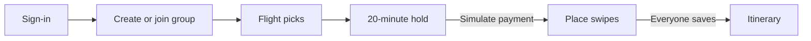
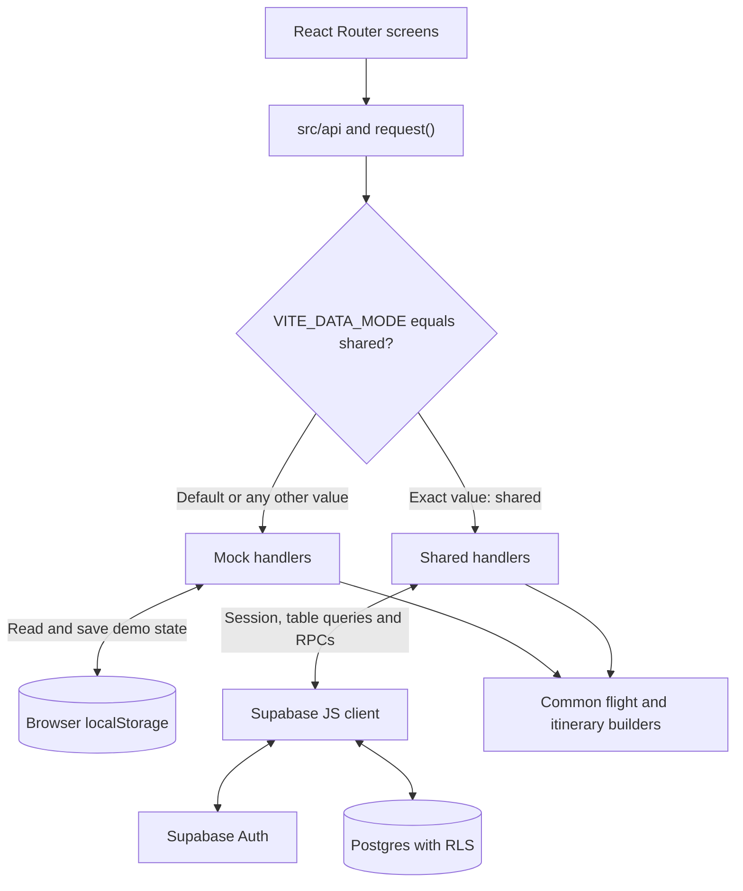
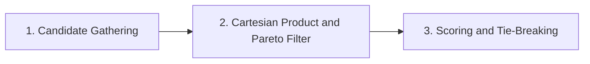
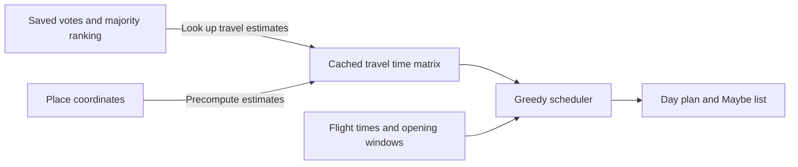

# Cathay Together architecture

## Three-minute walkthrough

Cathay Together coordinates a group trip to Tokyo Haneda (HND) on 21–24 November 2026. Each traveller picks their own flights and fare, then the group turns saved place votes into a shared itinerary.

- **What runs where.** React and Vite run the screens and algorithms in the browser. Mock mode saves to one browser. Shared mode uses Supabase Auth and Postgres so signed-in devices see the same trip.
- **What the demo calculates.** Real CX and UO schedules from a bundled OAG snapshot feed flight suggestions for lowest price, closest timing and the best trade-off. The board shows each traveller's picks. Fares, seats, holds, payments and tickets are simulated.
- **What shapes the itinerary.** A strict majority puts a place in the scheduling queue. The scheduler fits it around flights, opening hours and estimated travel. Minority picks and winners that cannot fit go to Maybe.

[Run the demo](README.md#run-it) · [Runtime modes](#data-flow-and-runtime-modes) · [Flight ranking](#group-flight-combination-suggestions) · [Itinerary rules](#itinerary-generation) · [Schema and payloads](DATA_DICTIONARY.md)

## Data flow and runtime modes

| Mode | Identity and persistence | Handler behaviour |
| --- | --- | --- |
| `mock` | Built-in personas and browser-local state under `cathay-mock-db-v4`. | [Mock handlers](src/api/mock/handlers.js) simulate latency. Demo controls switch personas, add demo members and force the next request to fail. |
| `shared` | Supabase Auth and Postgres. Signed-in devices read and change the same trip. | [Shared handlers](src/api/shared/handlers.js) call the Supabase JS client directly. `flightContext()` rebuilds saved selections from offer ID, cabin, fare and member airport. `tripContext()` adds member state and loads votes or a saved plan when needed. |

- **Dispatch.** React Router maps screens in [`App.jsx`](src/App.jsx). Screens use the async functions in [`src/api`](src/api). [`request()`](src/api/http.js) dispatches by method and path in the browser and coalesces identical concurrent GETs. [`config.js`](src/api/config.js) selects the mode.
- **Common calculations.** Both modes use `flightsFor()`, `makeSelection()`, `suggestionsFor()`, `boardFor()`, `bookingFor()`, `responseFor()`, `buildItinerary()` and the itinerary response and edit helpers from [`src/api/mock`](src/api/mock). Shared mode feeds them Supabase-backed state. Booking transitions use mode-specific storage and clocks.
- **Refresh.** While signed in and visible in shared mode, [`RequireSession`](src/features/auth/RequireSession.jsx) emits a refresh event every five seconds. [`useAsync()`](src/hooks/useAsync.js) listens and quietly re-reads data. Local actions also emit refresh events.

## Sign-in and group membership

1. **Restore the destination after sign-in.** [`RequireSession`](src/features/auth/RequireSession.jsx) sends signed-out visitors to `/sign-in?next=…` with the original route and query, including invite links. [`signIn()`](src/api/session.js) calls Supabase `signInWithPassword()`. The auth subscription supplies session state and the session survives reloads. Mock mode supplies a demo session.
2. **Complete a first-time profile.** [`RequireProfile`](src/features/auth/RequireProfile.jsx) calls `getCurrentUser()` and redirects on `profile_not_found` to `/welcome?next=…`. [Welcome](src/features/auth/WelcomePage.jsx) sends the display name and selected airport code via `PUT /me`. Its optional nearest-airport suggestion uses browser geolocation and local `distanceKm()`.
3. **Create and invite.** The form sends a group name, Tokyo destination and demo date-window ID. Shared `create_group()` generates a six-character code and inserts the group and creator membership in one transaction. Members shares `/invite/<code>` on the current app origin.
4. **Preview and join.** A signed-in invitee with a profile can call `preview_invitation()` for a group and member summary. Group flights, bookings, votes and the plan require membership. `join_group()` normalizes the code, checks the group/code pair for new members and makes repeat joins safe.
5. **Track invite actions.** `mark_invite_copied()` records a member's copy action. A shared decline lives in an in-memory set for the current tab until reload. Mock invitations and statuses persist in the local store.

## Flights and group ranking

- **Catalogue.** The [OAG snapshot](src/data/oagSnapshot.json) supplies CX and UO flight numbers and scheduled times. [`realJourneys()`](src/api/mock/realFlights.js) and [`buildJourneys()`](src/algorithms/connections.js) build direct journeys for Hong Kong and same-carrier journeys via HKG for other origins.
- **Connections and cabins.** A connection takes the shortest valid layover from 90 through 480 minutes. The second leg departs on the first leg’s local departure date or the next date.
- **Cabins.** Premium Economy and Business searches show CX itineraries only. The catalogue generates HKD fares and seat counts.
- **Selections.** Each member saves one flight and fare per direction. Search offers a one-way option. Starting a booking hold requires both legs.
- **Individual results.** [`othersTimes()` and `withTiming()`](src/api/mock/flightData.js) compare the candidate with other members who picked that direction. Once another member has picked, results sort by spread. The app compares the full spread for every candidate with no user-set arrival window.
  - **Displayed times.** `groupWindow` carries only other members’ displayed times. The arrival-window slider appears only as a specimen in the style guide.
- **Time comparison.** [`meetingInstant()` and `spreadMinutes()`](src/algorithms/arrivalWindow.js) use the last arrival outbound and the first departure on return. Spread is `round((latest − earliest) / 60000)` for epoch milliseconds, or zero with fewer than two instants. Clock strings are for display.
- **Older selections.** `legInstants()` reconstructs instants from the flight date, local clocks and airport offsets when stored instants are absent. It advances arrival by full days until arrival follows departure.

### Group flight combination suggestions

1. **Candidate gathering.** [`suggestionsFor()`](src/api/mock/flightData.js) works one direction at a time. For each unpicked member, it uses their home airport, the group start date outbound or end date on return, and the viewer's selected cabin at its lowest fare tier. Picked members keep their flight, date, cabin and fare price.
   - **Per-member extra.** A fixed pick has zero extra. Otherwise `extra` is the difference from that member's cheapest candidate.
2. **Cartesian product and Pareto filter.** [`rankCombinations()`](src/algorithms/combinations.js) tries every combination with one option per member. It returns zero combinations for an empty group or any member with no options. Each combination gets `total` (sum of HKD prices) and `spreadMinutes` (spread of meeting instants).
   - **Pareto filter.** For Best of Both, drop a combination if another costs no more and has no larger spread, with a strict improvement on either measure.
3. **Scoring and tie-breaking.** Rank the combinations by the rules below. The final tie-break is the concatenated flight IDs (joined with `|`).

| Label | Choose by | Ties before flight IDs |
| --- | --- | --- |
| Cheapest | Lowest `total` across all combinations | Smaller spread |
| Closest | Smallest `spreadMinutes` across all combinations | Lower total |
| Best of Both | Lowest `priceShare + timeShare` among Pareto survivors | Scores within `1e-9` tie. Smaller spread wins, then lower total. |

- **Price share.** `priceShare = (total − cheapest.total) / (closest.total − cheapest.total)`.
- **Time share.** `timeShare = (spread − closest.spread) / (cheapest.spread − closest.spread)`. In this formula, `spread` is `spreadMinutes`. A zero-width range contributes zero on either axis.
- **Display and selection.** A combination that wins multiple rules appears once with all its labels. `others` excludes those featured entries, sorts by the same balance score and tie-breaks, and defaults to 30 entries. It can include dominated combinations. A suggestion opens the viewer's own fare choice. Each member saves their own flight.

**Worked example.** A is fixed at HKD 2,000 and lands at 10:00. B has four outbound candidates. All arrival times are Tokyo local on the same day.

| B's arrival | B's fare (HKD) | Total (HKD) | Spread | Balance score | Result |
| --- | ---: | ---: | ---: | --- | --- |
| 11:00 | 1,000 | 3,000 | 60 min | `0 + 60/60 = 1.00` | Cheapest |
| 10:15 | 1,100 | 3,100 | 15 min | `100/300 + 15/60 ≈ 0.58` | Best of Both |
| 10:00 | 1,300 | 3,300 | 0 min | `300/300 + 0 = 1.00` | Closest |
| 10:50 | 1,200 | 3,200 | 50 min | `200/300 + 50/60 = 1.50` | Dominated by the 10:15 option |

A's extra is zero. B's extra in Best of Both is HKD 100 above B's HKD 1,000 cheapest flight.

## Board, simulated payment and swipes

- **Board.** [`boardFor()`](src/api/mock/boardHandlers.js) builds list and timeline views from member selections. The timeline groups equal instants and sorts across dates. Shared SQL derives status as `booked` after payment, `picked` with both directions selected, or `browsing` otherwise.
- **Payment.** Shared mode uses the database clock for the 20-minute hold and totals the caller's stored `price_minor` values on payment. Mock mode uses the browser clock. Both produce demo tickets and collect zero card details. See the [booking RPC transitions](DATA_DICTIONARY.md#public-rpcs).
- **Place votes.** Members swipe `like` or `pass` on 11 curated Tokyo places. [`responseFor()`](src/api/mock/preferenceHandlers.js) builds choices and readiness. Shared mode passes the full catalogue to `save_preferences()`. The `votes_unsave_preferences` trigger clears readiness on a vote write. Mock mode mirrors this in its store.

## Itinerary generation

### Travel-time rules

[OpenStreetMap coordinates](src/data/placeGeo.js) feed [`travel.js`](src/algorithms/travel.js). `travelTable()` caches estimates by place pair in the itinerary builder.

| Case | Rule |
| --- | --- |
| Distance | `distanceKm()` uses Haversine with Earth radius 6,371 km. Adjusted distance `d = 1.3 × distanceKm(a, b)`. |
| Walk, `d ≤ 1.2 km` | Raw minutes `60 × d / 5` at 5 km/h. |
| Transit, `d > 1.2 km` | Raw minutes `10 + 60 × d / 25`, with 10 minutes of overhead and 25 km/h in transit. |
| Estimated pair | `travelMinutes()` returns `max(5, ceil(rawMinutes / 5) × 5)`. |
| Unknown pair | Flat 20-minute gap, including pairs with suggested fillers. |
| Airport connectors | Flat 60 minutes for displayed airport-to-city and city-to-airport connectors. Flight buffers below bound the scheduler's availability. |

### Scheduling rules

| Decision | Exact rule |
| --- | --- |
| Vote ranking | Count likes from saved preferences. The denominator includes all group members. A winner satisfies `liked × 2 > total`. Sort by descending likes, then catalogue order. A non-winner with at least one like goes to Maybe. Zero likes drops the place. |
| Trip clock | Trip minutes are measured from 00:00 Tokyo time on the first trip date. For example, day two at 09:30 is `1440 + 570 = 2010`. |
| Flight buffers | Start 90 minutes after the latest selected outbound arrival. End 180 minutes before the earliest selected return departure. A direction with zero picks leaves that side open to the trip boundary. These are the full airport allowances for scheduling. |
| Daily window | Intersect group availability, 08:00–21:30 Tokyo time and the place's curated `open` and `close`. Exclude closed days. |
| Day order | Fewest voted stops first. Break ties by preferring middle days on trips longer than two days, then earlier days. |
| Start times | Try the preferred time first when set (13:00 for Afternoon, 17:30 for Evening, none for Morning). Then try the window opening and existing stops' end times plus travel, earliest first. Clamp to the window opening and round up to 15 minutes. |
| Fit | The full visit must fit within the window and leave the required travel time around other stops. Earlier placements stay fixed. |
| Filler slots | Morning 08:00–12:00, afternoon 12:00–17:30, evening 17:30–21:30. Skip if a voted stop starts in that slot, or if the filler cannot fit on its assigned day with the same time and travel rules. |

1. **Check readiness and rank votes.** `buildItinerary()` requires every member to have saved and reports `not_ready` with the waiting members otherwise. [`votesFor()`](src/api/mock/itineraryData.js) tallies saved votes. [`rankVotes()`](src/algorithms/itinerary.js) separates majority winners from Maybe.
2. **Prepare travel and time windows.** `buildPlan()` uses the cached matrix and `groupFreeTime()` to derive availability from saved legs. `allowedWindow()` intersects the windows. `closedDays()` translates the encoded weekday closures into trip day indices.
   - **Hours and closures.** [`placeData.js`](src/api/mock/placeData.js) holds curated opening times. [`placeGeo.js`](src/data/placeGeo.js) encodes Shinjuku Gyoen's Monday closure. Raw OSM hours for Shinjuku Gyoen, Sensō-ji, Tokyo Tower and Zōjō-ji are reference metadata. © OpenStreetMap contributors.
3. **Place winners greedily.** [`schedule()`](src/algorithms/itinerary.js) tries days in the order above. `findStart()` takes the first valid start on the first day that fits. If none fits, the winner is recorded in `didNotFit` and shown in Maybe.
4. **Fill gaps.** `schedule()` tries the predefined fillers in their assigned slots after the voted stops. It then sorts each day's stops by start time.
5. **Check, save and render.** `buildPlan()` stores [`checkPlan()`](src/algorithms/itinerary.js) findings in `plan.problems`, including day count, duplicate or unknown stops, duration, closures, time bounds, travel gaps, majority violations and unaccounted-for winners. The shared handler upserts one JSON plan per group in `itineraries`.
   - **Viewer-specific display.** `assemble()` adds the viewer's flights or placeholders and the travel connectors on read. Estimated daily JPY cost is the sum of stop costs plus a ¥1,000 allowance on the first and last days and ¥500 on middle days.

## Security and demo constraints

- **Database boundary.** Row-level security (RLS) filters direct reads. Users can write their own profile, and members can write their own selections and votes. Any member can upsert their group's itinerary as themselves. Groups and memberships use checked RPCs for app writes. Booking access is RPC-only. Public RPCs use `SECURITY DEFINER` and check the caller via `auth.uid()`. See [direct table access](DATA_DICTIONARY.md#direct-table-access).
- **Flight validation.** The handler validates the offer and blocks edits after payment. Database grants and RLS allow members to write their own selections subject to schema constraints. Catalogue prices and the post-payment lock are enforced at the app layer.
- **Itinerary validation.** The database checks membership, author ID and that `plan` is a JSON object. Generation records checker findings and saves even if it finds problems. `budget_per_person_jpy` is descriptive and there is no scheduler budget cap.
- **Manual edits.** Any member can generate or edit the plan in the app. Edits validate the day lists and stop IDs, then `retimePlan()` calls `retimeDay()`. This path skips `checkPlan()` and can save closure or time-window violations. Older plans without `free` keep their existing times.
