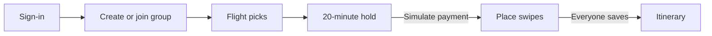
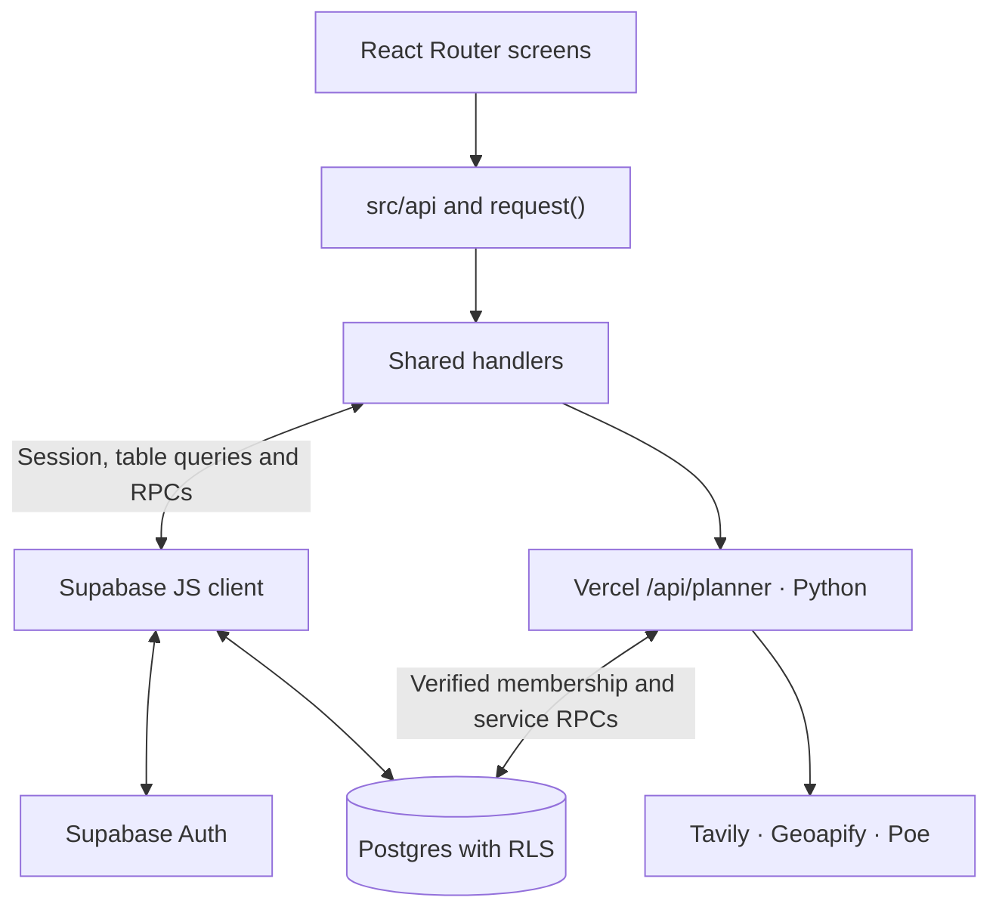
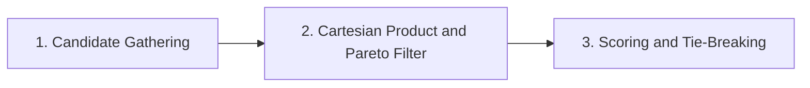
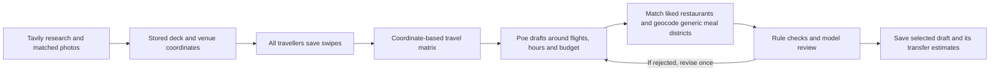

# Cathay Together architecture

## Three-minute walkthrough

Cathay Together coordinates a group trip to Tokyo Haneda (HND) on 21–24 November 2026. Each traveller picks their own flights and fare, then the group turns saved place votes into a shared itinerary.

- **What runs where.** React and Vite run the screens and flight algorithms. Supabase handles sign-in and trip data, and a Python planner runs on Vercel.
- **What the demo calculates.** Real CX and UO schedules from a bundled OAG snapshot feed flight suggestions for lowest price, closest timing and the best trade-off. The board shows each traveller's picks. Fares, seats, holds, payments and tickets are simulated.
- **What shapes the itinerary.** The planner researches venues with Tavily, geocodes them with Geoapify and uses Poe to draft and review the plan.

[Run the demo](README.md#run-it) · [Data flow](#data-flow) · [Flight ranking](#group-flight-combination-suggestions) · [Itinerary rules](#itinerary-generation) · [Schema and payloads](DATA_DICTIONARY.md)

## Data flow

- **Dispatch.** React Router maps screens in [`App.jsx`](src/App.jsx). Screens use async functions in [`src/api`](src/api). [`request()`](src/api/http.js) dispatches by method and path and coalesces identical concurrent GETs.
- **Read shared data.** [`flightContext()`](src/api/shared/handlers.js) rebuilds saved selections from offer ID, cabin, fare and member airport. `tripContext()` adds member state and loads votes or the saved plan when requested.
- **Refresh.** While signed in and visible, [`RequireSession`](src/features/auth/RequireSession.jsx) emits a refresh event every five seconds. [`useAsync()`](src/hooks/useAsync.js) listens and quietly re-reads data. Local actions also emit refresh events.

## Sign-in and group membership

1. **Restore the destination after sign-in.** [`RequireSession`](src/features/auth/RequireSession.jsx) sends signed-out visitors to `/sign-in?next=…` with the original route and query, including invite links. [`signIn()`](src/api/session.js) calls Supabase `signInWithPassword()`. The auth subscription supplies session state and the session survives reloads. The shared group list offers Sign out.
2. **Complete a first-time profile.** [`RequireProfile`](src/features/auth/RequireProfile.jsx) calls `getCurrentUser()` and redirects on `profile_not_found` to `/welcome?next=…`. [Welcome](src/features/auth/WelcomePage.jsx) sends the display name and selected airport code via `PUT /me`. Its optional nearest-airport suggestion uses browser geolocation and local `distanceKm()`.
3. **Create and invite.** The form sends a group name, Tokyo destination and demo date-window ID. Shared `create_group()` generates a six-character code and inserts the group and creator membership in one transaction. Members shares `/invite/<code>` on the current app origin.
4. **Preview and join.** A signed-in invitee with a profile can call `preview_invitation()` for a group and member summary. Group flights, bookings, votes and the plan require membership. `join_group()` normalizes the code, checks the group/code pair for new members and makes repeat joins safe.
5. **Track invite actions.** `mark_invite_copied()` records a member's copy action. A shared decline lives in an in-memory set for the current tab until reload. The creator can delete the group for everyone with `delete_group()`. A joined member can leave with `leave_group()`.

## Flights and group ranking

- **Catalogue.** The [OAG snapshot](src/data/oagSnapshot.json) supplies CX and UO flight numbers and scheduled times. [`realJourneys()`](src/api/shared/realFlights.js) and [`buildJourneys()`](src/algorithms/connections.js) build direct journeys for Hong Kong and same-carrier journeys via HKG for other origins.
- **Connections and cabins.** A connection takes the shortest valid layover from 90 through 480 minutes. The second leg departs on the first leg’s local departure date or the next date.
- **Cabins.** Premium Economy and Business searches show CX itineraries only. The catalogue generates HKD fares and seat counts.
- **Selections.** Each member saves one flight and fare per direction. Search offers a one-way option. Starting a booking hold requires both legs.
- **Individual results.** [`othersTimes()` and `withTiming()`](src/api/shared/flightData.js) compare the candidate with other members who picked that direction. Once another member has picked, results sort by spread. The app compares the full spread for every candidate with no user-set arrival window.
  - **Displayed times.** `groupWindow` carries only other members’ displayed times. The arrival-window slider appears only as a specimen in the style guide.
- **Time comparison.** [`meetingInstant()` and `spreadMinutes()`](src/algorithms/arrivalWindow.js) use the last arrival outbound and the first departure on return. Spread is `round((latest − earliest) / 60000)` for epoch milliseconds, or zero with fewer than two instants. Clock strings are for display.
- **Older selections.** `legInstants()` reconstructs instants from the flight date, local clocks and airport offsets when stored instants are absent. It advances arrival by full days until arrival follows departure.

### Group flight combination suggestions

1. **Candidate gathering.** [`suggestionsFor()`](src/api/shared/flightData.js) works one direction at a time. For each unpicked member, it uses their home airport, the group start date outbound or end date on return, and the viewer's selected cabin at its lowest fare tier. Picked members keep their flight, date, cabin and fare price.
   - **Per-member extra.** A fixed pick has zero extra. Otherwise `extra` is the difference from that member's cheapest candidate.
2. **Cartesian product and Pareto filter.** [`rankCombinations()`](src/algorithms/combinations.js) tries every combination with one option per member. It returns zero combinations for an empty group or any member with no options. Each combination gets `total` (sum of HKD prices) and `spreadMinutes` (spread of meeting instants).
   - **Pareto filter.** For Best of Both, drop a combination if another costs no more and has no larger spread, with a strict improvement on either measure.
3. **Scoring and tie-breaking.** Rank the combinations by the rules below. The final tie-break is the concatenated flight IDs (joined with `|`).

| Label | Choose by | Ties before flight IDs |
| --- | --- | --- |
| Cheapest | Lowest `total` across all combinations | Smaller spread |
| Closest | Smallest `spreadMinutes` across all combinations | Lower total |
| Best of Both | Lowest `priceShare + timeShare` among Pareto survivors | Scores within `1e-9` tie. Smaller spread wins, then lower total. |

- **Price share.** `priceShare = (total − cheapest.total) / (closest.total − cheapest.total)`.
- **Time share.** `timeShare = (spread − closest.spread) / (cheapest.spread − closest.spread)`. In this formula, `spread` is `spreadMinutes`. A zero-width range contributes zero on either axis.
- **Display and selection.** A combination that wins multiple rules appears once with all its labels. `others` excludes those featured entries, sorts by the same balance score and tie-breaks, and defaults to 30 entries. It can include dominated combinations. A suggestion opens the viewer's own fare choice. Each member saves their own flight.

**Worked example.** A is fixed at HKD 2,000 and lands at 10:00. B has four outbound candidates. All arrival times are Tokyo local on the same day.

| B's arrival | B's fare (HKD) | Total (HKD) | Spread | Balance score | Result |
| --- | ---: | ---: | ---: | --- | --- |
| 11:00 | 1,000 | 3,000 | 60 min | `0 + 60/60 = 1.00` | Cheapest |
| 10:15 | 1,100 | 3,100 | 15 min | `100/300 + 15/60 ≈ 0.58` | Best of Both |
| 10:00 | 1,300 | 3,300 | 0 min | `300/300 + 0 = 1.00` | Closest |
| 10:50 | 1,200 | 3,200 | 50 min | `200/300 + 50/60 = 1.50` | Dominated by the 10:15 option |

A's extra is zero. B's extra in Best of Both is HKD 100 above B's HKD 1,000 cheapest flight.

## Board, simulated payment and swipes

- **Board.** [`boardFor()`](src/api/shared/boardData.js) builds list and timeline views from member selections. The timeline groups equal instants and sorts across dates. Shared SQL derives status as `booked` after payment, `picked` with both directions selected, or `browsing` otherwise.
- **Payment.** The database clock controls the 20-minute hold. Payment totals the caller’s stored `price_minor` values and issues a demo ticket. The app collects zero card details. The shared confirmation screen shows a 10% bonus miles message and a demo redemption control. See the [booking RPC transitions](DATA_DICTIONARY.md#public-rpcs).
- **Place votes.** Members swipe `like` or `pass` on the group deck. [`responseFor()`](src/api/shared/preferenceData.js) builds choices and readiness. The shared `save_preferences()` RPC verifies the stored deck IDs. The `votes_unsave_preferences` trigger clears readiness after a vote write. Existing trips with legacy votes retain their original cards.

## Itinerary generation

1. **Prepare a stable deck.** [`run_discover()`](server/itinerary/pipeline.py) calls the Explorer and Curator. Tavily searches named venues, including restaurants and cafés, and photo matching uses image descriptions. Geoapify matches named venues to coordinates. Pre-existing votes keep their legacy deck.
2. **Use authoritative inputs.** [`/api/planner`](server/app.py) verifies the Supabase session and membership, claims a database lease, and reads the trip, votes, flight instants and budget. `cards_for_plan()` requires a saved choice from each member for every card.
3. **Draft and review.** `run_plan()` gives Poe the highest-voted places, the travel matrix and the group’s exact daily windows. It can substitute popular food cards into generic lunch or dinner slots. Generic meals with a known district use the district centre to estimate travel before review.
4. **Persist and display.** The server saves the selected draft, review and exact transfer estimates. The browser renders the saved estimates and viewer-specific flight cards. Transfers display a single “estimated transfer” label. [Detailed scheduling and review rules](LOGIC.md#2-shared-ai-itinerary-planner)

| Decision | Shared rule |
| --- | --- |
| Vote ranking | Prioritize `likes × 2 ≥ members`, sorted by approval share. Other liked places can be scheduled. Zero likes excludes a place. Unscheduled liked places go to Maybe. |
| Availability | 08:00–21:30 in the destination, from 90 minutes after the latest selected arrival until 180 minutes before the earliest selected departure. |
| Placement | Poe considers known opening hours, weekday closures, pace, meal slots, and the per-person activity and meal budget. The server checks the result. |
| Transfers | The distance formula below uses 30 minutes for missing coordinates. A short transfer is a warning. |
| Revision | The planner can try one revision when review rejects a draft. It saves the reviewed draft with the fewest errors, preferring the later draft on a tie. Without a usable draft the UI offers **Try again**. |

**Saved-plan freshness.** The build endpoint compares `fingerprint` with current members, votes and flight times. The itinerary screen currently opens an existing saved plan directly, so opening it can bypass that check.

### Travel-time rules

| Case | Rule |
| --- | --- |
| Distance | [`distance_km()`](server/itinerary/travel.py) uses Haversine with an Earth radius of 6,371 km. Adjusted distance `d = 1.3 × distance_km(a, b)`. |
| Walk, `d ≤ 1.2 km` | Raw minutes `60 × d / 5` at 5 km/h. |
| Transit, `d > 1.2 km` | Raw minutes `10 + 60 × d / 25`, with 10 minutes of overhead and 25 km/h in transit. |
| Estimated pair | `estimate_minutes()` returns `max(5, ceil(rawMinutes / 5) × 5)`. |
| Missing coordinate | 30-minute fallback for new plans. |

**Older shared trips.** [`legacyPlaces.js`](src/data/legacyPlaces.js) preserves the original swipe cards. [`assemble()`](src/api/shared/itineraryData.js) still reads older plans with no saved transfer matrix. Non-AI plans display legacy coordinate estimates, a 20-minute fallback and 60-minute airport connectors. The daily allowance is ¥1,000 on the first and last days and ¥500 on middle days.

## Security and demo constraints

- **Database boundary.** Row-level security (RLS) filters direct reads. Users can write their own profile, and members can write their own selections and votes. The planner service writes generated shared itineraries. Members can update their group’s existing plan with their own user ID as author. Groups and memberships use checked RPCs for app writes. Booking access is RPC-only. Browser RPCs use `SECURITY DEFINER` and resolve the caller via `auth.uid()`. Planner RPCs are service-role only. See [direct table access](DATA_DICTIONARY.md#direct-table-access).
- **Flight validation.** The handler validates the offer and blocks edits after payment. Database grants and RLS allow members to write their own selections subject to schema constraints. Catalogue prices and the post-payment lock are enforced at the app layer.
- **Itinerary validation.** The database checks that `plan` is a JSON object. Shared generation verifies membership and compares the original inputs again before committing. The shared checker flags plans above `budget_per_person_jpy`.
- **Manual edits.** Any member can generate or edit the plan in the app. Edits validate day lists and stop IDs. Shared AI plans use `retimeResearchedPlan()` for same-day edits, with saved transfers and flight and opening windows. Older non-AI shared plans use `retimePlan()` and `retimeDay()`. Plans without a stored `free` window keep their existing times.
